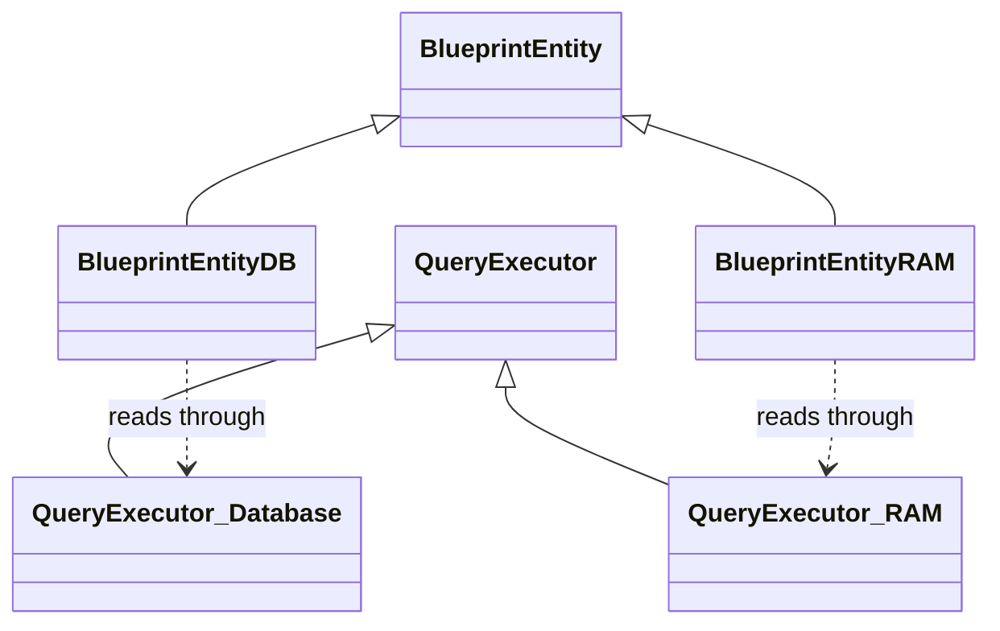

# Query Executors

Consumers use the same LINQ Entity API for both `BlueprintEntityDB` and `BlueprintEntityRAM`. Blueprint selects the executor from the entity's inheritance. This selection also applies separately to every entity loaded through `AutoInclude`.

| Entity base | Executor | Read source outside transactions |
| --- | --- | --- |
| `BlueprintEntityDB` | `QueryExecutor_Database` | SQL, including when the parent is a RAM entity. |
| `BlueprintEntityRAM` | `QueryExecutor_RAM` | Synchronized RAM for eligible reads, including when the parent is a DB entity. Unsupported root queries retain SQL fallback. |



The executors are internal implementation classes, not consumer configuration objects. `EntityQueryProvider` owns one selected executor for the query. The common `QueryExecutor` base holds `fDatabase`, `fContract`, `fProvider`, and `fLanguage`; derived executors reuse those fields. The RAM executor delegates unsupported queries and transaction reads to its database executor.

## A DB product with a RAM category

This standalone model uses separate example tables. Import the namespaces below and register Product; its Category contract is discovered automatically.

```csharp
using Blueprint.Entities;
using Blueprint.Entities.Annotations;
using Microsoft.EntityFrameworkCore;
using System.ComponentModel.DataAnnotations.Schema;

namespace QueryExecutorExample
{
    /// <summary>Stores products in SQL while loading their included categories from RAM.</summary>
    [Entity("ExecutorProducts")]
    public abstract class Product : BlueprintEntityDB
    {
        public abstract int ReleaseYear { get; set; }

        [Precision(18, 2)]
        public abstract decimal Price { get; set; }

        public abstract long? CategoryID { get; set; }

        [ForeignKey(nameof(CategoryID)), AutoInclude]
        public abstract Category? Category { get; set; }
    }

    /// <summary>Keeps SQL-persisted category titles in the synchronized RAM cache.</summary>
    [Entity("ExecutorCategories")]
    public abstract class Category : BlueprintEntityRAM
    {
        [Multilingual]
        public abstract string? Title { get; set; }
    }
}
```

With the database initialized, the contracts in scope, and `System.Linq` and `System.Collections.Generic` imported:

```csharp
database.RegisterEntity<Product>();
IQueryable<Product> query = Product.Where(p => p.ReleaseYear == 2026 && p.Price < 200m);
List<Product> products = query.OrderBy(p => p.Price).ThenBy(p => p.ID).Take(20).ToList();
int count = query.Count();
bool exists = query.Any();
```

`Where`, `OrderBy`, `Select`, `Skip`, and `Take` compose a deferred expression. Enumeration and terminal operations such as `ToList`, `Count`, `Any`, and `Single` execute it. In this model, the product filter and paging execute in SQL. After materializing products, their `CategoryID` values select categories through `QueryExecutor_RAM`. No consumer-side executor selection is needed.

To use RAM products with SQL categories, change Product's base to `BlueprintEntityRAM` and Category's base to `BlueprintEntityDB`, then rebuild and initialize the model again. The LINQ calls stay the same; products now come from RAM and included categories from SQL. Persistence remains SQL for both classes.

## References, collections, and nested relationships

`AutoInclude` requests relationship loading; it never changes the related entity's DB/RAM mode. Both references and collections use the target entity's executor. A RAM → DB → RAM path reads each level from its own source. DB classes are not automatically added to RAM cache or Change Tracking because another entity includes them.

Relationship keys are batched for each navigation and source. Returned entities are independent of cached snapshots. Inverse references and collections are connected on the returned objects, and cyclic paths stop expanding when a type repeats. The query language is applied to every loaded level, including multilingual fallback.

Counts and scalar-only projections do not load unrelated AutoInclude graphs. Eligible RAM queries that access declared include paths evaluate those paths over the graph assembled from the respective sources. SQL queries and SQL fallback continue to evaluate their predicates and projections in SQL; selecting the source for AutoInclude materialization does not rewrite arbitrary SQL joins into in-memory joins.

## Consistency, transactions, and failures

A mixed graph can combine current SQL values with an older RAM snapshot. For example, an external update to a DB child is visible on the next read while an external update to a RAM sibling waits for synchronization. A RAM target absent from the current snapshot produces a missing reference or no matching collection entry; it is not silently fetched from SQL solely because the snapshot has no match.

Inside a Blueprint transaction, roots and all AutoInclude levels read SQL through the database executor, including RAM entity classes. This preserves the transaction's isolation and visibility of its uncommitted writes. Writes always go to SQL, and subsequent cache reads synchronize committed state after invalidation.

Cache synchronization and query errors propagate. A failed refresh is not silently converted into a successful SQL result. SQL fallback is used for unsupported query shapes or when cache execution is unavailable, such as during a transaction. See [Transactions](Database-Transactions.md) and [RAM Caching](Database-RAMCaching.md).

## Related topics

[Entity classes](Entitites-BlueprintEntity.md) · [Queries and CRUD](Database-QueriesAndCRUD.md) · [Relationships](Entitites-Relationships.md) · [RAM Caching](Database-RAMCaching.md)
