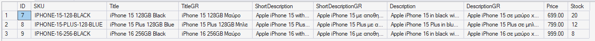

# SQL Server

`SqlDatabase`, in the `Blueprint.Database.Sql` namespace, is Blueprint's Microsoft SQL Server provider. It inherits configuration, entity registration, and resource management from the abstract [BlueprintDatabase](Database-BlueprintDatabase.md) class and implements `IDisposable`.

This guide covers connection settings, languages, entity registration, and application lifetime. Its complete example follows the [EntitiesTutorial](../Visual%20Studio%20Project/Blueprint.Tests/Tutorial1/EntitiesTutorial.cs) initialization flow.

Before writing code, read [Contributing](Contributing.md). Follow [Getting Started](Getting-Started.md) to reference Blueprint in a .NET 10 application using C# 14.

## Configuration and languages

Every database is configured with a name, a connection string, and a `List<BlueprintLanguage>`. The base constructor validates and stores these settings; the concrete provider establishes the database connection and initializes its context.

For SQL Server, the public constructor is `SqlDatabase(string name, string connectionString, List<BlueprintLanguage> languages)`. The database name overrides `Database` or `Initial Catalog` in the connection string. Connection or database-creation errors can occur during construction.

Create each language with `new BlueprintLanguage(id, prefix)`. Its `ID` and `Prefix` are read-only properties; do not assign them with an object initializer.

The language list must satisfy these rules:

- Supply at least one language, including for a single-language application.
- Each language has a unique `long` ID chosen by the application.
- Prefixes are unique without distinguishing uppercase and lowercase letters.
- Exactly one language has `string.Empty` as its prefix. This is the default language, regardless of its ID or position in the list.
- Null languages, null prefixes, and nonempty whitespace-only prefixes are rejected.

The database keeps an independent copy of the list. Changing the supplied list later does not reconfigure its languages. After activation, read the configured languages through `database.Languages`. For translation storage, language selection, and changing language configurations, see [Multilingual Entities](Database-Multilingual-Entities.md).

### A database with one language

If the database does not need multiple languages, define one default language instead of the English and Greek fields:

```csharp
private static readonly BlueprintLanguage fDefaultLanguage = new BlueprintLanguage(1, String.Empty);
```

Then build the language list inside `Main()` with that single language:

```csharp
List<BlueprintLanguage> languages = new List<BlueprintLanguage>();
languages.Add(fDefaultLanguage);
```

The database still requires a language list even when the application uses only one language. Its sole language must have an empty prefix. The name `fDefaultLanguage` does not prescribe a particular natural language; the application chooses which language it represents.

## Connection string used by EntitiesTutorial

The tutorial connects to a local SQL Server Express instance using Windows authentication:

```csharp
string sqlServerConnectionString = "Server=.\\SQLEXPRESS;Integrated Security=True;Encrypt=True;TrustServerCertificate=True;";
```

The server must already be installed and running. Blueprint can create the application database, but it does not install SQL Server or start its service.

| Setting | Meaning |
| --- | --- |
| `Server=.\SQLEXPRESS` | Selects the named `SQLEXPRESS` instance on the local computer. |
| `Integrated Security=True` | Connects using the application's Windows identity. |
| `Encrypt=True` | Encrypts the connection to this SQL Server instance. |
| `TrustServerCertificate=True` | Skips certificate validation for this local-development connection. |

In a regular C# string literal, write `\\` for the single backslash in an instance name. The connection string received by the driver contains `.\SQLEXPRESS`. Connection-string values are separated by semicolons. See Microsoft's [connection-string reference](https://learn.microsoft.com/en-us/sql/connect/ado-net/connection-strings?view=sql-server-ver17).

`TrustServerCertificate=True` does not disable encryption when used with `Encrypt=True`, but it skips verification of the server certificate. For deployment, use `TrustServerCertificate=False` with a certificate trusted by the client and a server name matching that certificate. See [encryption and certificate validation](https://learn.microsoft.com/en-us/sql/connect/ado-net/encryption-and-certificate-validation?view=sql-server-ver17).

## Select the server, instance, or TCP port

These are values for the `Server` setting, shown as connection-string text rather than escaped C# literals:

| Server value | Target |
| --- | --- |
| `.` | Default SQL Server instance on the local computer. |
| `.\SQLEXPRESS` | Local instance named `SQLEXPRESS`. |
| `sql.example.com\SHOP` | Instance named `SHOP` on another server. |
| `tcp:sql.example.com,1433` | The specified server over TCP on port 1433. |

Use the port configured for your SQL Server; a named instance can use a different port. For TCP connections, enable TCP/IP on the server and allow access to its listening port. Named-instance discovery can require SQL Server Browser; specifying the TCP host and port avoids relying on instance discovery. See Microsoft's [SQL Server connection guidance](https://learn.microsoft.com/en-us/sql/sql-server/connect-to-database-engine?view=sql-server-ver17).

For example, replace the tutorial's connection string with this one when using a reachable server, Windows authentication, and a valid server certificate:

```csharp
string sqlServerConnectionString = "Server=tcp:sql.example.com,1433;Integrated Security=True;Encrypt=True;TrustServerCertificate=False;Connect Timeout=30;";
```

Replace `sql.example.com` and the port with your actual endpoint. `Connect Timeout=30` limits the time allowed to establish a connection; it does not configure query execution time. See the [SqlClient connection options](https://learn.microsoft.com/en-us/dotnet/api/microsoft.data.sqlclient.sqlconnection.connectionstring?view=sqlclient-dotnet-7.1).

## Choose authentication

### Windows authentication

Use `Integrated Security=True` when SQL Server should authenticate the identity running the application. A console application normally runs as the signed-in Windows user; a service or hosted application may run under a different account. That account needs access to the SQL Server instance and the application database.

### SQL Server authentication

SQL authentication requires a SQL Server login and a server configured to accept SQL authentication. Use `User ID` and `Password` with integrated security disabled. If `Integrated Security=True` is also present, the driver uses Windows authentication and ignores those credentials. See [SQL Server and Windows authentication](https://learn.microsoft.com/en-us/sql/connect/ado-net/sql/authentication-sql-server?view=sql-server-ver17).

The following alternative reads credentials from application environment variables and uses `SqlConnectionStringBuilder` to encode their values. Place these statements inside the entry method and import `Microsoft.Data.SqlClient` and `System` at the top of the file:

```csharp
string sqlUserName = Environment.GetEnvironmentVariable("BLUEPRINT_SQL_USER") ?? throw new InvalidOperationException("BLUEPRINT_SQL_USER is not configured.");
string sqlPassword = Environment.GetEnvironmentVariable("BLUEPRINT_SQL_PASSWORD") ?? throw new InvalidOperationException("BLUEPRINT_SQL_PASSWORD is not configured.");
SqlConnectionStringBuilder settings = new SqlConnectionStringBuilder("Server=tcp:sql.example.com,1433;Integrated Security=False;Encrypt=True;TrustServerCertificate=False;Connect Timeout=30;");
settings.UserID = sqlUserName;
settings.Password = sqlPassword;
string sqlServerConnectionString = settings.ConnectionString;
```

Supply the variables through the application's configuration environment; do not put real credentials in the tutorial or log the completed connection string. This fragment replaces the Windows-authentication connection-string declaration. The remaining Blueprint initialization stays the same.

## Database name and constructor behavior

The provider constructor accepts the database name separately from the connection string:

```csharp
BlueprintDatabase db = new SqlDatabase("MyEshopDatabase", sqlServerConnectionString, languages);
```

| Argument | Purpose |
| --- | --- |
| `"MyEshopDatabase"` | The application database to create or open. |
| `sqlServerConnectionString` | Server, authentication, encryption, and connection options. |
| `languages` | The configured `List<BlueprintLanguage>`, including exactly one language with an empty prefix. |

The name argument overrides any `Database` or `Initial Catalog` value in the supplied connection string. Supplying a different database name only in that string does not select a different application database.

Construction connects immediately. The current provider first connects to `master` to check for and, if necessary, create the named database, then initializes the application context. The account therefore needs access to `master` and the application database, plus database-creation permissions if the database is missing. Connection failures can occur before `RegisterEntity<Product>()` is called.

The provider requires a server value, rejects `AttachDBFilename`, and does not accept `master`, `model`, `msdb`, or `tempdb` as the application database. Database names must contain 1 to 128 characters without leading or trailing whitespace or control characters. These rules come from the [SqlDatabase implementation](../Visual%20Studio%20Project/Blueprint/Database/Sql/SqlDatabase.cs).

## Complete example from EntitiesTutorial

The following standalone `Program.cs` adapts the tutorial with `public static void Main()` and private static fields. It includes Product and the three iPhone inserts. Use this as one complete example, rather than combining it with another `Main()` from the manual.

It uses the local Windows-authentication connection string, English and Greek, and a five-second cache refresh interval. Product derives from `BlueprintEntityRAM`, so the account also needs the cache permissions described below.

```csharp
using Blueprint.Database;
using Blueprint.Database.Sql;
using Blueprint.Fundamentals;
using Blueprint.Entities.Annotations;
using Blueprint.Entities;
using Microsoft.EntityFrameworkCore;
using System;
using System.Collections.Generic;

namespace BlueprintManual
{
    internal class EntitiesTutorial
    {
        private static readonly BlueprintLanguage fEnglishLanguage = new BlueprintLanguage(1, String.Empty); // English is the default language with no suffix
        private static readonly BlueprintLanguage fGreekLanguage = new BlueprintLanguage(2, "GR"); // Greek has the suffix GR for multilingual columns

        /// <summary>Initializes the tutorial database, saves sample iPhones with English and Greek content, and releases resources.</summary>
        /// <exception cref="Exception">Database initialization, product insertion, or shutdown fails.</exception>
        public static void Main()
        {
            // Step 1 - Configure the database connection.
            string sqlServerConnectionString = "Server=.\\SQLEXPRESS;Integrated Security=True;Encrypt=True;TrustServerCertificate=True;";

            // Step 2 - Initialize the languages used by the application.
            // Multilingual columns have a suffix for each non-default language.
            List<BlueprintLanguage> languages = new List<BlueprintLanguage>();
            languages.Add(fEnglishLanguage);
            languages.Add(fGreekLanguage);

            // Step 3 - Initialize the database and register the entities used by the application.
            BlueprintDatabase db = new SqlDatabase("MyEshopDatabase", sqlServerConnectionString, languages);
            db.RAMCacheRefreshInterval = TimeSpan.FromSeconds(5);
            using (db)
            {
                db.RegisterEntity<Product>();

                // Step 4 - Insert sample iPhones into the database.
                InsertProductsToDatabase();
            }
        }

        /// <summary>Creates and saves three sample iPhones with both translations, prices, and stock quantities.</summary>
        /// <remarks>Prices and stock quantities are demonstration values. Each call inserts new rows.</remarks>
        /// <exception cref="InvalidOperationException">Blueprint or the Product entity has not been initialized.</exception>
        /// <exception cref="System.Data.Common.DbException">Communication with the database fails.</exception>
        /// <exception cref="DbUpdateException">The products cannot be saved.</exception>
        private static void InsertProductsToDatabase()
        {
            Product iphone15 = Product.Create();
            iphone15.SKU = "IPHONE-15-128-BLACK";
            iphone15.Price = 699.00m;
            iphone15.Stock = 20;
            // English
            iphone15.CurrentLanguage = fEnglishLanguage.ID;
            iphone15.Title = "iPhone 15 128GB Black";
            iphone15.ShortDescription = "Apple iPhone 15 with 128GB storage in black.";
            iphone15.Description = "Apple iPhone 15 in black with 128GB of storage for apps, photos, and videos.";
            // Greek
            iphone15.CurrentLanguage = fGreekLanguage.ID;
            iphone15.Title = "iPhone 15 128GB Μαύρο";
            iphone15.ShortDescription = "Apple iPhone 15 με αποθηκευτικό χώρο 128GB σε μαύρο χρώμα.";
            iphone15.Description = "Apple iPhone 15 σε μαύρο χρώμα με αποθηκευτικό χώρο 128GB για εφαρμογές, φωτογραφίες και βίντεο.";
            Product.Insert(iphone15);

            Product iphone15Plus = Product.Create();
            iphone15Plus.SKU = "IPHONE-15-PLUS-128-BLUE";
            iphone15Plus.Price = 799.00m;
            iphone15Plus.Stock = 12;
            // English
            iphone15Plus.CurrentLanguage = fEnglishLanguage.ID;
            iphone15Plus.Title = "iPhone 15 Plus 128GB Blue";
            iphone15Plus.ShortDescription = "Apple iPhone 15 Plus with 128GB storage in blue.";
            iphone15Plus.Description = "Apple iPhone 15 Plus in blue with 128GB of storage for apps, photos, and videos.";
            // Greek
            iphone15Plus.CurrentLanguage = fGreekLanguage.ID;
            iphone15Plus.Title = "iPhone 15 Plus 128GB Μπλε";
            iphone15Plus.ShortDescription = "Apple iPhone 15 Plus με αποθηκευτικό χώρο 128GB σε μπλε χρώμα.";
            iphone15Plus.Description = "Apple iPhone 15 Plus σε μπλε χρώμα με αποθηκευτικό χώρο 128GB για εφαρμογές, φωτογραφίες και βίντεο.";
            Product.Insert(iphone15Plus);

            Product iphone16 = Product.Create();
            iphone16.SKU = "IPHONE-16-256-BLACK";
            iphone16.Price = 999.00m;
            iphone16.Stock = 8;
            // English
            iphone16.CurrentLanguage = fEnglishLanguage.ID;
            iphone16.Title = "iPhone 16 256GB Black";
            iphone16.ShortDescription = "Apple iPhone 16 with 256GB storage in black.";
            iphone16.Description = "Apple iPhone 16 in black with 256GB of storage for apps, photos, and videos.";
            // Greek
            iphone16.CurrentLanguage = fGreekLanguage.ID;
            iphone16.Title = "iPhone 16 256GB Μαύρο";
            iphone16.ShortDescription = "Apple iPhone 16 με αποθηκευτικό χώρο 256GB σε μαύρο χρώμα.";
            iphone16.Description = "Apple iPhone 16 σε μαύρο χρώμα με αποθηκευτικό χώρο 256GB για εφαρμογές, φωτογραφίες και βίντεο.";
            Product.Insert(iphone16);
        }
    }

    /// <summary>Describes a product with multilingual content, a price, and stock quantity.</summary>
    [Entity("Products")]
    public abstract class Product : BlueprintEntityRAM
    {
        public abstract string SKU { get; set; }

        [Multilingual]
        public abstract string Title { get; set; }

        [Multilingual]
        public abstract string ShortDescription { get; set; }

        [Multilingual]
        public abstract string Description { get; set; }

        [Precision(18, 2)]
        public abstract decimal Price { get; set; }

        public abstract int Stock { get; set; }
    }
}
```

### What happens when it runs

The constructor opens or creates MyEshopDatabase and activates it for the Entity API. Inside the using block, registration synchronizes dbo.Products and loads its cache, and `InsertProductsToDatabase()` saves the three products.



Each product occupies one row. The multilingual fields have default-language columns such as `Title` and Greek columns such as `TitleGR`; `SKU`, `Price`, and `Stock` are shared. A successful run adds three rows. Prices and stock quantities are demonstration values, and rerunning the example inserts another three rows without checking for existing SKUs.

The using block disposes the database even if registration or insertion fails. Disposal clears the active database and releases resources; it does not delete the SQL database or saved products.

The refresh interval configures polling while the database is active. This console example exits after insertion; it does not stay running for repeated cache refreshes. See [Configuration and languages](#configuration-and-languages) and [Application lifetime](#application-lifetime) for the corresponding setup and disposal rules.

## Register entity contracts

Use `database.RegisterEntity<Product>()` to add a contract. The equivalent overload is `database.RegisterEntity(typeof(Product))`; these are alternative forms of the same registration.

Each contract must be a public, non-sealed class deriving from `BlueprintEntityDB` or `BlueprintEntityRAM`, marked with `[Entity]`. Related entity contracts are discovered from registered contracts; Blueprint does not scan all loaded assemblies for entities.

Registration performs provider work immediately. With SQL Server, it synchronizes the schema and loads every discovered `BlueprintEntityRAM` table, including its translations, before returning. Related DB entities remain SQL-backed. Repeating registration for the same type synchronizes again without adding a duplicate registration.

New contracts can also be registered through `database` after database initialization. If synchronization or cache loading fails, a newly added registration is removed and the previous active model and cache remain available. This does not mean every SQL Server configuration change is undone; see [Schema Synchronization](Database-Entities-Schema-Synchronization.md) and [RAM Caching](Database-RAM-Caching.md) for details.

## Shared properties and services

| Member | Purpose |
| --- | --- |
| `Name` | Gets the configured database name. It has no setter. |
| `ConnectionString` | Gets the provider's connection settings. It has no setter; SQL Server stores the connection string with the configured database name. |
| `RAMCacheRefreshInterval` | Gets or sets the interval for checking external changes to RAM-cached data. The default is one second. |
| `RegisterEntity<TEntity>()` / `RegisterEntity(Type)` | Registers a contract and synchronizes the provider's model, schema, and optional cache. |
| `Languages` | Gets the independent, read-only language configuration. |
| `Dispose()` | Clears the active database, releases resources, and prevents further data operations. |

`RAMCacheRefreshInterval` accepts values from one millisecond through the supported timer range, and can be changed before or after entity registration. It configures polling only for entities derived from `BlueprintEntityRAM`; AutoInclude DB targets use their database executor. The interval is not a guaranteed maximum delay before external changes become visible. See [RAM Caching](Database-RAM-Caching.md).

The languages are configured at construction and exposed through `BlueprintDatabase.Languages`, not through a writable database property. To use another connection or language configuration, create a new database instance and register its entities.

## Data access through entities

Use the database for configuration, registration, and lifetime management. Create and access data through the Entity API, such as `Product.Create()`, `Product.Where(...)`, `Product.Insert(...)`, and `Product.Update(...)`.

Although `BlueprintDatabase` exposes `Create<TEntity>()`, direct use of this helper belongs to Blueprint's implementation. The former `Collection<TEntity>()` helper has been removed; queries and writes are accessed through the Entity API. Applications, demos, and tests use the Entity API. Import `Blueprint.Entities` in files using its static extensions.

Entities returned by queries are independent instances without permanent tracking. Changing a property does not save it automatically; call the appropriate Entity method. See [EShop - Checkout Tutorial](Database-Tutorial-EShop-Checkout.md) and [Queries and CRUD](Database-Queries-and-CRUD.md).

## Execute SQL commands

Use `database.ExecuteNonQuery(commandText, parameters, commandTimeoutSeconds)` for direct SQL Server commands without a result set. It returns the affected-row count supplied by SQL Server, including zero when no rows match or `-1` when a count is unavailable, such as with `SET NOCOUNT ON`. SQL errors propagate as `SqlException`; the method does not retry automatically or wrap a batch in a transaction.

This example assumes an initialized `database` and the ID of an existing Product from the checkout tutorial:

```csharp
using Microsoft.Data.SqlClient;
using System.Data;
using System.Data.Common;

SqlParameter price = new SqlParameter("@price", SqlDbType.Decimal) { Precision = 18, Scale = 2, Value = 19.95m };
SqlParameter id = new SqlParameter("@id", SqlDbType.BigInt) { Value = productID };
int affectedRows = database.ExecuteNonQuery("UPDATE dbo.Products SET Price = @price WHERE ID = @id;", new DbParameter[] { price, id }, commandTimeoutSeconds: 30);
```

The SQL uses physical table and column names. This method does not apply multilingual mapping, entity validation, or optimistic concurrency checks automatically. Include any required concurrency condition in the SQL. Schema changes do not automatically rebuild Blueprint's active model.

Parameters are optional. Each supplied item must be a non-null `Microsoft.Data.SqlClient.SqlParameter` that is not attached to another command. Values of `null` are sent as `DBNull.Value`. Output parameter values remain available on the supplied instances. Parameters are detached on success or failure so they can be reused sequentially; do not share or mutate parameter objects during concurrent calls. Commands and values remain separate; parameter values are not inserted into the SQL text.

The timeout is optional: null leaves the command default supplied by SqlClient and the connection settings, zero disables the command timeout, and negative values are rejected. This is a command timeout, not a deadline covering connection establishment or waiting for local synchronization.

Each call creates and disposes its own SQL connection with automatic transaction enlistment disabled. It does not use the shared entity context or hold the database lock while SQL runs. Concurrent calls use independent connections; connection pooling follows the configured connection string. Calls from an existing database operation, including transaction preparation or validation callbacks, and calls inside an ambient `TransactionScope` are rejected. Use `TransactionFactory` for its supported queued entity operations.

The method briefly uses the database lock to check disposal and, after releasing its connection, to invalidate the current local RAM cache. The next cached read synchronizes committed changes without waiting for the polling interval. Invalidation also occurs after execution errors, because a batch may have committed earlier statements. Other servers synchronize through their own Change Tracking polling, and already returned entity objects remain unchanged.

Disposal rejects new calls but does not cancel or wait for an independent command that has already passed the lifetime check. Wait for outstanding calls before shutting down the application or switching databases. Cache invalidation is skipped if that database instance has already been disposed.

## Application lifetime

Keep one active `BlueprintDatabase` for the application. Successful provider initialization activates it automatically; creating another database while one is active throws. Failed initialization does not replace the active database. Its resources must remain available while queries, writes, and background work are running. A query returned by Where still needs its original database when it is enumerated, for example by `ToList()`.

At application shutdown, stop or dispose any independent `BackgroundTasksManager` instances that use the database, then dispose the database. A manager waits for its running tasks and callbacks; database disposal does not stop managers. See [Background Tasks](Background-Tasks.md) for a nested using example that guarantees this order.

Use a using block to dispose any successfully constructed database even when entity registration or application work fails. Disposal can be called repeatedly. After disposal, static Entity calls fail until a new database is initialized, and operations tied to the old database reject further use.

When switching configurations, finish existing work, dispose the old database, create and register the new one, and reload entities against its model. Resume or recreate background tasks only after the new contracts are registered.

## Concurrent access

Database operations coordinate through a shared lock to protect the EF Core context. Query execution, writes, registration, and disposal on the same database instance use this synchronization.

This synchronization does not make concurrent edits to an entity object safe, and it does not synchronize separate database instances or processes. Those writers are governed by database isolation, constraints, and concurrency tokens.

## Permissions for initialization and caching

The current provider needs a SQL identity that can connect to `master` and the application database. When objects are missing, initialization and registration also need permissions to create the database and synchronize its tables, columns, indexes, and sequences. Product insertion needs the corresponding write permissions.

Because the tutorial derives Product from `BlueprintEntityRAM`, registration prepares SQL Server Change Tracking and snapshot isolation. Enabling missing settings requires the corresponding `ALTER DATABASE` and `ALTER TABLE` permissions. Reading the cache requires `SELECT` and `VIEW CHANGE TRACKING` on the relevant tables. Existing settings can already be provisioned by an administrator. See [RAM caching requirements](Database-RAM-Caching.md#sql-server-requirements) and [Schema Synchronization](Database-Entities-Schema-Synchronization.md).

## Connection and initialization problems

| Symptom | Check |
| --- | --- |
| Server or instance cannot be reached | Confirm the service, endpoint, configured TCP port, and network access. For a named instance, check instance discovery or use its explicit TCP port. |
| Login failed | Check the application's actual Windows identity or the supplied SQL login, the server's authentication mode, and database permissions. |
| Certificate validation fails | Check the server certificate's trust, expiry, and host name. Keep the local-development exception separate from deployment settings. |
| A different database is selected than expected | Check the first `SqlDatabase` constructor argument; it overrides the connection string's database value. |
| Construction fails even though the database exists | This provider still connects to `master` during its initial check; inspect the exception and the account's access. |
| Construction succeeds but registration fails | Inspect schema compatibility and permissions; `BlueprintEntityRAM` also needs Change Tracking and snapshot isolation. |

Use the SQL exception and its inner exception to identify the failing stage. General setup and persistence errors are covered in [Troubleshooting](Troubleshooting.md).

## Related topics

[BlueprintDatabase](Database-BlueprintDatabase.md) · [Getting Started](Getting-Started.md) · [RAM Caching](Database-RAM-Caching.md) · [Schema Synchronization](Database-Entities-Schema-Synchronization.md) · [User manual](README.md)
